

# Shiftwell

**Multi-tenant HR platform for UAE and GCC shift teams: Core HR, self-serve signup with live AED pricing, and a two-factor operator console.**

[Live site](https://shiftwell.everbuild.cloud) · [Console sign-in](https://app.shiftwell.everbuild.cloud) · [Portfolio](https://portfolio.everbuild.cloud) · [LinkedIn](https://linkedin.com/in/dafallah-ibrahim)

> [!NOTE]
> This is a showcase repository. The source code is private because Shiftwell is company work, built at **Sudan Tech Solutions (STS)** and shared here with permission. This repo covers what the product does, how it is built and what I did on it. I'm happy to walk through the code in an interview.

  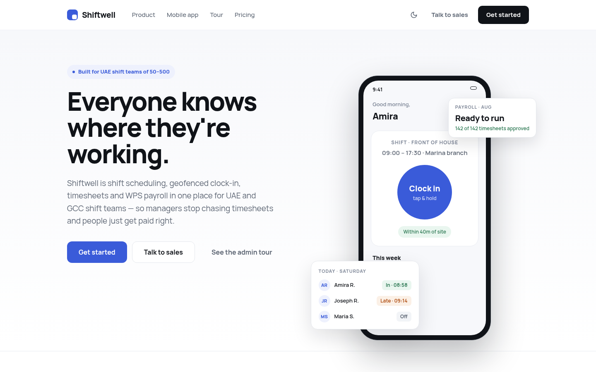

  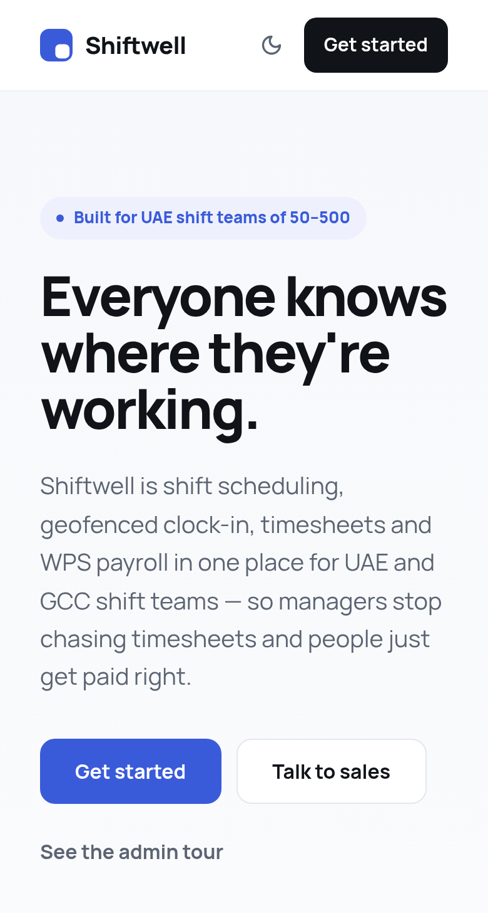
  &nbsp;
  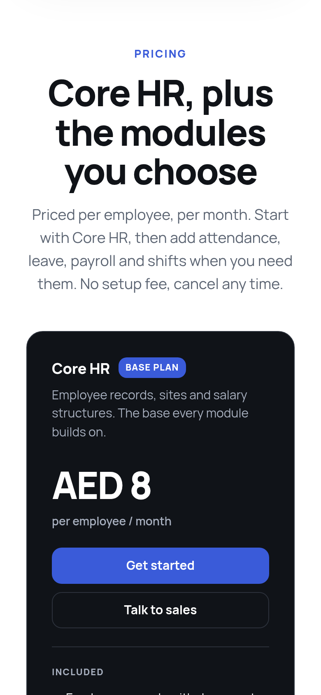
  &nbsp;
  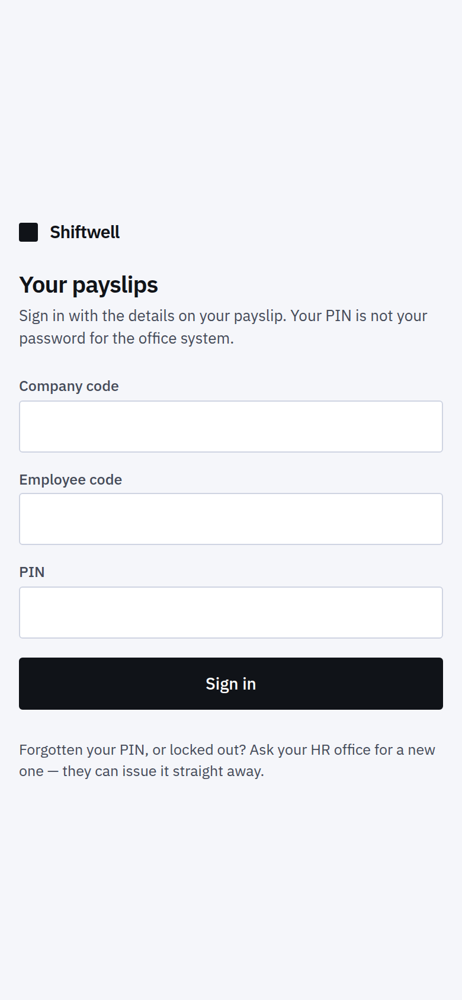

  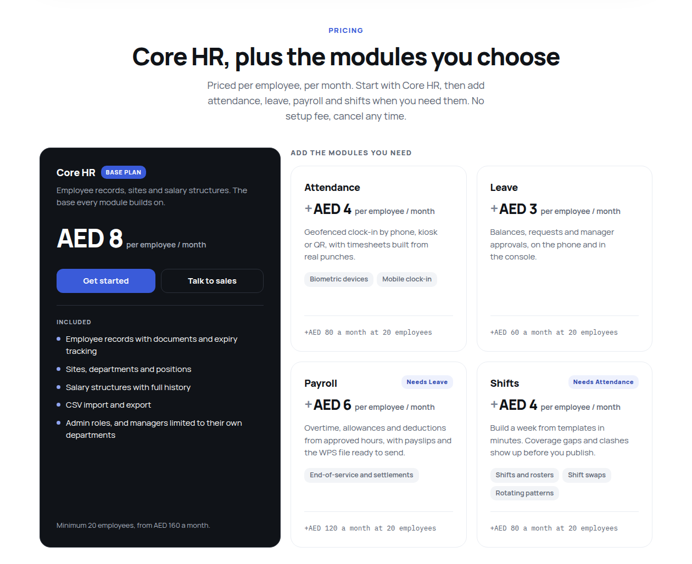

  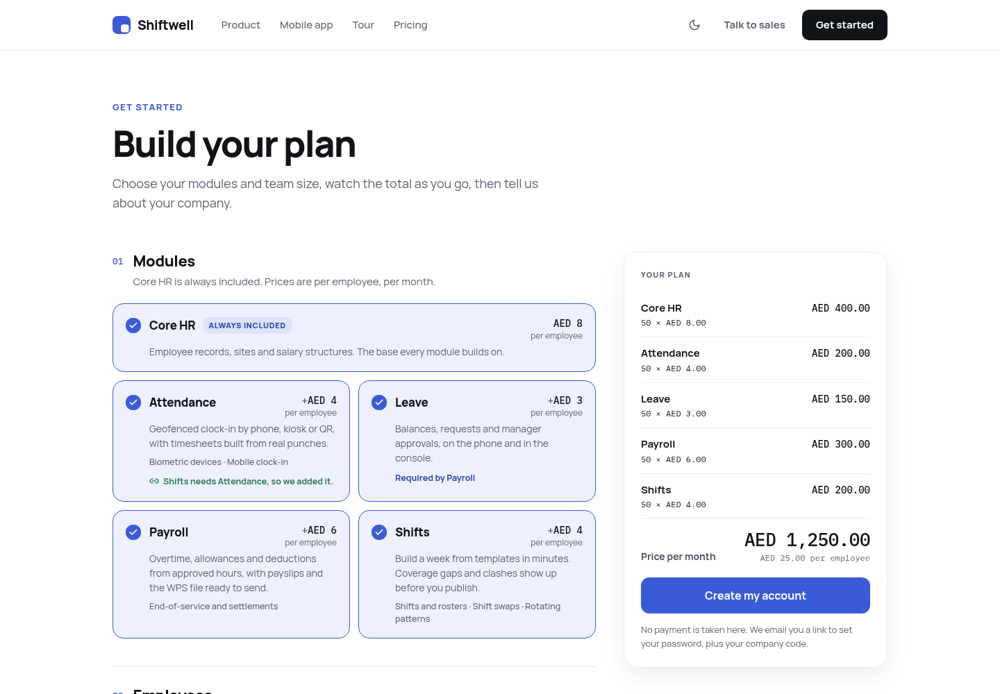

  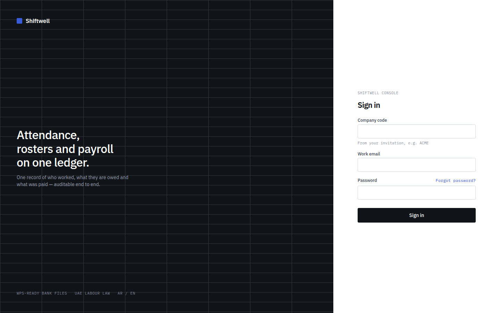
  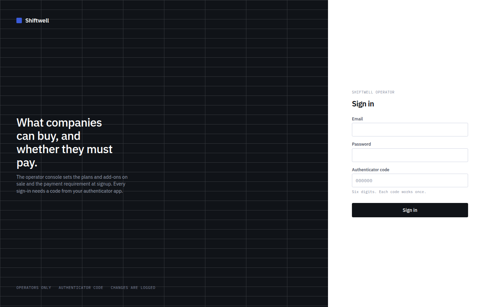

  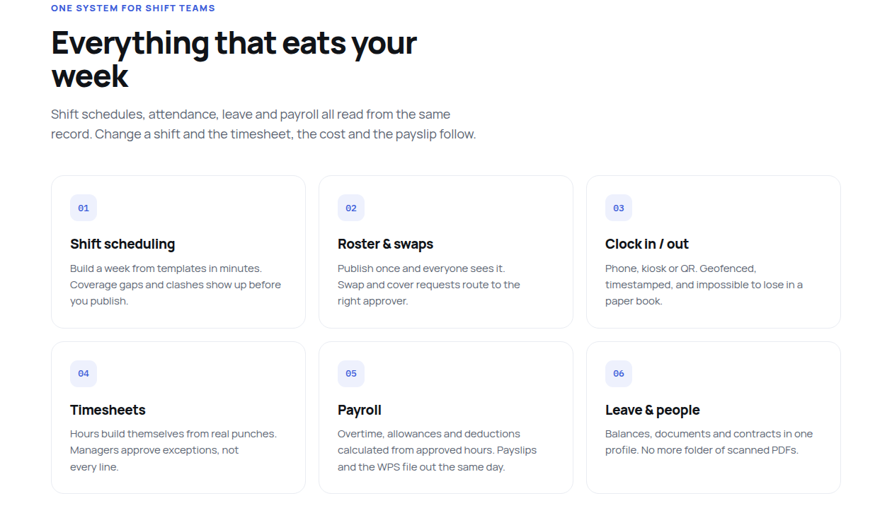

  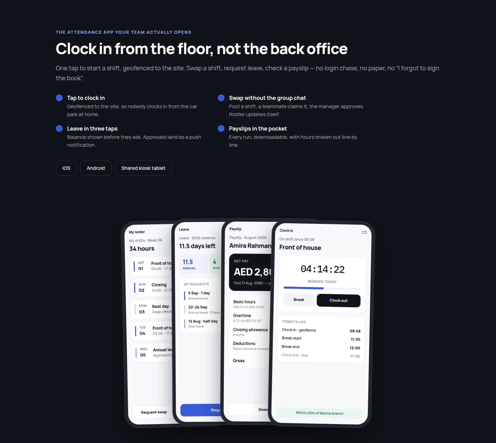

  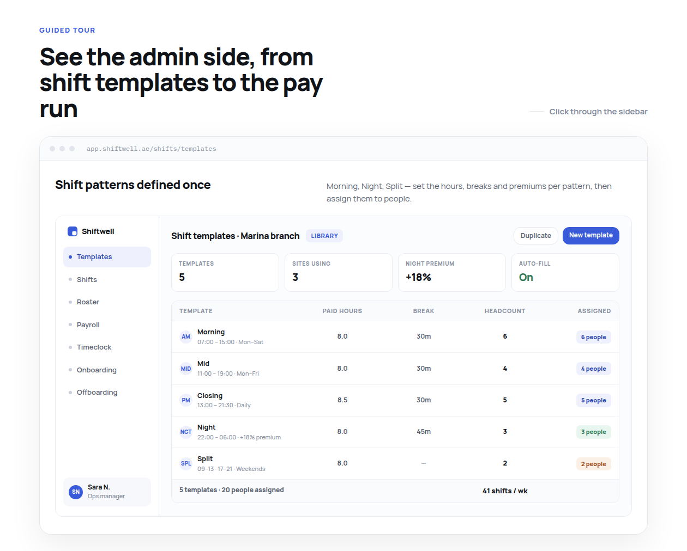
  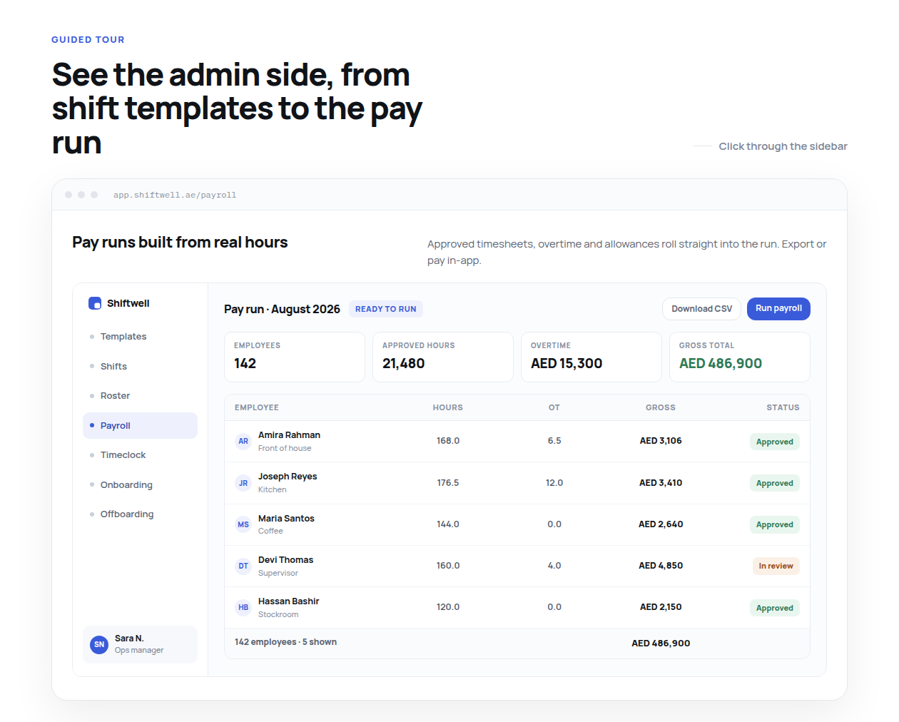

All screenshots are real captures of the live sites. The phone stack and the admin tour are interactive mock-ups on the marketing page, filled with illustrative sample data shipped with the marketing site (URLs shown inside the mock-ups are illustrative too). They show the planned modules and are not captures of the signed-in console. No real company or employee data appears anywhere.

## Features

**Core HR, in the admin console**
- Employee records with sites, departments and positions. Employees are never hard-deleted: they are marked terminated, so their history is kept.
- Salary structures versioned by date, so a raise closes one version and opens the next and past figures can be reproduced.
- Identity documents with uploaded scans, and a dashboard card for documents that are about to expire.
- Bank details whose form comes from the employee's country (IBAN in the UAE, account number and IFSC in India). Only the owner and finance roles can see or edit them.
- Employee import and export by CSV.
- Console users with the roles owner, HR admin, finance and manager. Managers see only their own departments. Colleagues join by emailed invitation, and there is self-service password reset.

**Employee portal**
- A phone-first sign-in with company code, employee code and PIN. HR issues the first PIN, and the employee must change it before seeing anything else.
- Revoking access or terminating an employee closes any open session immediately.

**Self-serve signup and billing**
- The landing page reads plans, add-ons and prices live from the API, priced in AED per employee per month.
- At checkout the buyer chooses modules and head-count. Dependencies are added automatically (Shifts needs Attendance, Payroll needs Leave), and the server prices the order again rather than trusting the page.
- The company is created with exactly the modules that were bought, and the owner gets an email link to set a password.
- Entitlements gate features, navigation and limits (employees, sites, console users). A cancelled company is locked out of everything except sign-in and the renewal screen.

**Operator console** (a separate host)
- Sign-in needs a password and a TOTP authenticator code, and each code works only once. Operators are invited from the CLI with a one-time setup link and a QR code.
- Operators manage the plan and add-on catalogue and turn the payments requirement on or off. If a price changes after a company has bought it, the change is saved as a new version (`core_v1` → `core_v2`), so existing customers keep the terms they bought.

**Planned modules.** The landing page sells Attendance, Shifts, Leave and Payroll (with the UAE WPS salary file). In the API they exist as isolated module scaffolds behind the entitlement system. Work on the leave schema had started by the last commit. Payroll is designed but not yet implemented (see [docs/architecture.md](docs/architecture.md)).

## Architecture

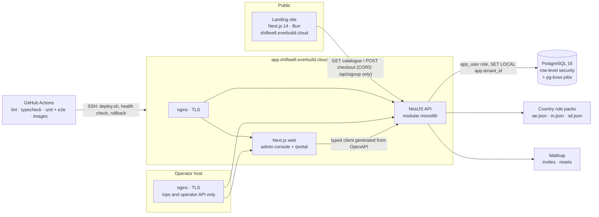

The API is one deployable with walls inside it. `core/` holds tenancy, identity, org, billing, signup and operator. `modules/` holds attendance, shifts, leave and payroll, kept as islands. `bridges/` is the only place two modules meet. Lint enforces these boundaries, so a cross-module import fails the build. There's more depth in [docs/architecture.md](docs/architecture.md).

### Key engineering decisions

- **Tenant isolation in three layers.** Every tenant table has `tenantId` as the first column of every index. PostgreSQL row-level security is turned on and forced on every tenant table. Each request runs in a transaction that sets the tenant with `SET LOCAL`, never plain `SET`, so a pooled connection cannot carry one company's data into another company's request. The API connects as a role that owns nothing. Foreign keys are composite on tenant and id, because Postgres runs its integrity checks with RLS bypassed. A dedicated e2e suite proves the isolation, and it refuses to run as a role that could bypass RLS.
- **Auth that fails closed.** The global guards run in a fixed order: JWT, then audience, then roles, then subscription. After them, an interceptor (not middleware) sets the tenant from the verified token. A route without a declared audience is rejected. Refresh tokens rotate within a family, and replaying a used one revokes the whole family. Access is re-read from the database on every request. Sign-in errors never reveal whether an account exists, and per-account lockout works alongside per-IP rate limits.
- **Money is integer fils.** No floats or decimal strings. The money helpers split amounts so the parts always add up exactly to the total, because a one-fil discrepancy gets a WPS bank file rejected.
- **Country rules are data.** Identity document types, bank-account fields and formats, and salary-component tags come from per-country JSON rule packs. Supporting a new country means adding a file, not a schema change or an `if (country === 'AE')`.
- **The OpenAPI document is the contract.** The console's API types are generated from it, and CI fails if they are stale. An e2e test fails on any route without a summary, a response schema or correct security, and on any money field that isn't an integer.
- **Deploys are automatic and safe to repeat.** Every push to `main` runs lint, type checks, unit tests, e2e tests against PostgreSQL 16 and the production image builds, then deploys over SSH. The deploy script sets the server up on its first run, and later runs check health and roll back an unhealthy release. Because a rollback reverts code but not the schema, migrations are additive only.

## Tech stack

| Layer | Tech |
| --- | --- |
| API | NestJS 10, TypeScript, Prisma (pg adapter), class-validator, zod, Swagger/OpenAPI |
| Database | PostgreSQL 16 with hand-written RLS policies, exclusion constraints (`btree_gist`) and triggers |
| Background jobs | pg-boss, which runs inside Postgres (no Redis) |
| Auth | JWT access tokens + rotating refresh tokens in httpOnly cookies, argon2, TOTP for operators |
| Admin console and portal | Next.js 14 (App Router), React 18, Tailwind CSS, Radix UI primitives |
| Landing and checkout | Next.js 14, Tailwind, shadcn/ui, Bun, schema.org structured data |
| Mail | Mailtrap (invitations, password resets, operator setup) |
| Infra | Docker Compose, nginx + certbot, Caddy for local HTTPS, GitHub Actions CI/CD to a VPS |
| Quality | ESLint with architecture-boundary rules, Jest unit tests and e2e suites, generated API types checked in CI |

## My role

I worked on Shiftwell at **Sudan Tech Solutions (STS)**. I built the landing site and checkout on my own, and led the API work after the initial import:

- **Landing site and checkout:** I wrote all 17 commits in its repository (September to October 2026), covering the design build, SEO and structured data, the contact form, live catalogue pricing, self-serve checkout and the VPS deploy pipeline.
- **API and console:** the organisation's repository starts with a single import commit of the existing codebase, made by a teammate. Of the 26 commits after it, I wrote 25 (17 changes plus 8 merges, 29 Sep to 1 Oct 2026). They add self-serve signup, the operator console with two-factor sign-in and emailed invitations, the free plan, landing checkout support, automatic deploys to the VPS, and a series of security and correctness fixes. A teammate added the first leave-module schema on 8 Oct 2026, and the leave module is being built by a teammate on a separate branch.
- I wrote the AI/engineering guide (AGENTS.md) and the deploy runbook, and kept the architecture guide and roadmap in line with the code as features landed.

## Status

Live. The landing site went up in September 2026, and the app has been deployed automatically since 30 September 2026:
- Landing site: [shiftwell.everbuild.cloud](https://shiftwell.everbuild.cloud)
- Admin console and employee portal: [app.shiftwell.everbuild.cloud](https://app.shiftwell.everbuild.cloud), where you sign in with a company code
- Operator console: on its own TOTP-protected host, for platform staff only

Core HR, the employee portal, billing, signup and the operator console are in production. Attendance, shifts, leave and payroll are next on the roadmap. The checkout currently runs with payments switched off, so a company is created at signup, until a real payment provider is integrated.

---

© Sudan Tech Solutions (STS). Shared with permission. Source code is private.
