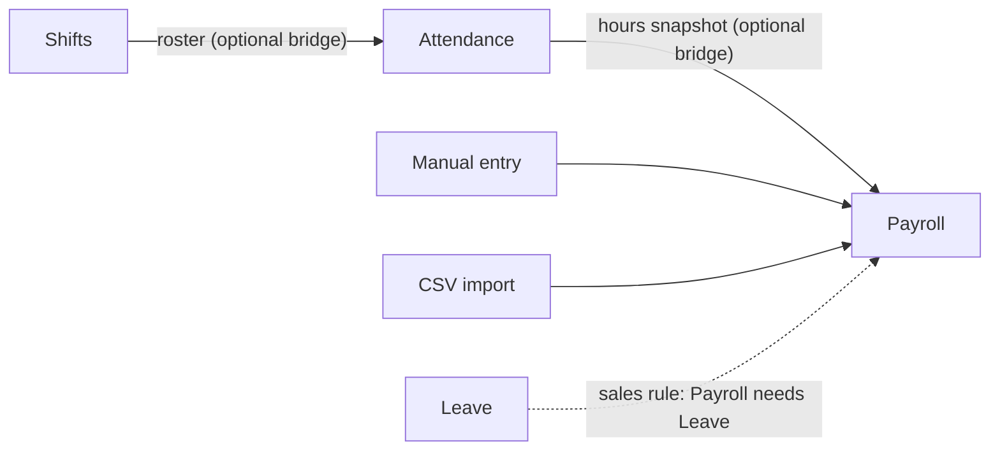
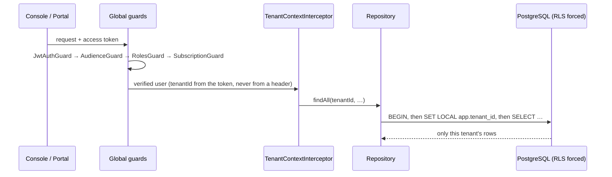
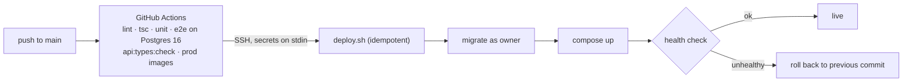

# Shiftwell architecture

This page goes deeper than the README. Everything here comes from the project's own architecture guide, its code layout, its configuration and its tests. The code itself is private.

## A modular monolith with enforced walls

Shiftwell is a single NestJS deployable, organised so that it could be split later without untangling:

```
core/     tenancy, identity, org, billing, signup, operator, reports   (anything may use these)
modules/  attendance, shifts, leave, payroll                            (islands)
bridges/  the only place two modules meet
shared/   money, time, errors, rule-pack helpers                        (pure, no I/O)
infra/    prisma, queue (pg-boss), storage, mail, rule-pack loader
```

- A module may import only `core/`, `shared/` and `infra/`. Each module exposes exactly one `index.ts`.
- `eslint-plugin-boundaries` enforces both the layer graph and the single entry point, and a violation fails the build.
- The only code that may ask "does this tenant have module X?" lives in `bridges/`.
- Raw SQL (`$queryRaw`, `$executeRaw`) is a lint error anywhere outside the Prisma infrastructure folder, because that folder holds the controlled escape hatch past RLS.

### How the modules depend on each other



Payroll is designed to read a `PayrollInputSnapshot` from one of three providers: manual entry, a CSV import or the attendance bridge. It never queries attendance tables. Which modules must be bought together (Shifts needs Attendance, Payroll needs Leave) is a **sales rule**, not an import between modules. It is checked at checkout and on every change to a subscription.

## Multi-tenancy



- **Schema:** every tenant table has `tenantId`, and it is the first column of every index. Uniqueness is always scoped by tenant.
- **Row-level security:** hand-written migrations enable and **force** RLS with a `tenant_isolation` policy that has both `USING` and `WITH CHECK`. The API connects as `app_user`, which owns nothing and is not a superuser. Migrations run as the owner role.
- **Request context:** `withTenant()` opens a transaction and runs `SET LOCAL`. The tenant id is validated as a UUID first, because `SET LOCAL` cannot be parameterised. `asSystem()` is the deliberate cross-tenant escape hatch, and every call site has a comment explaining why it is safe there.
- **Composite foreign keys:** Postgres runs its integrity checks with RLS bypassed, so every relation references `(tenantId, id)`. Otherwise one tenant could point a row at another tenant's record.
- **Company code, not subdomain:** a tenant is never identified from the host name, because per-company subdomains would reveal who the customers are. Sign-in is the one place a client-supplied tenant is accepted, and only to look up credentials that are then verified.

## Identity: three doors

| Door | Credential | Notes |
| --- | --- | --- |
| Admin console | company code + email + password | Rotating refresh tokens. Replaying a used one revokes the whole family, with a 30-second grace window for tabs that reload together. |
| Employee portal | company code + employee code + PIN | The PIN is argon2-hashed and issued once by HR. It must be changed before first use. Repeated or sequential digits are refused. |
| Operator console | email + password + TOTP | A separate host. No refresh tokens. The API refuses operator routes on any other host. |

- Every protected route must declare an audience. An employee token is refused on admin routes whatever its roles, because a PIN is a weaker credential than a password.
- On every request, the API re-reads the user's roles and active status from the database.
- A database trigger guarantees that a company always keeps an active owner, even if two owners demote each other at the same moment.
- Lockout (five failures locks the account for 30 minutes) protects a single account. Per-IP rate limits, different for each door, protect against one address trying many accounts.

## Billing and entitlements

- The catalogue holds plans and add-ons priced per employee in minor units. Plans carry feature keys and limits (employees, sites, console users).
- Features are gated with `@RequiresFeature` and checked by an entitlement service with a short cache. Grandfathering is enforced: a price change after a sale creates a new version, and existing companies keep what they bought.
- Signup is a public catalogue plus checkout, with CORS opened only on `/api/signup` for the landing page's origin. An operator-controlled switch decides whether payment is required before the company is created.

## Delivery



- The first deploy creates the database, roles, nginx sites and certificates. Later deploys rebuild, migrate and check health.
- Secrets reach the server on SSH stdin, never on a command line, because other accounts on the server can read command lines.
- Migrations must be additive, because a rollback reverts code but not the schema.

---

<sub>© Sudan Tech Solutions (STS). Shared with permission. Source code is private.</sub>
